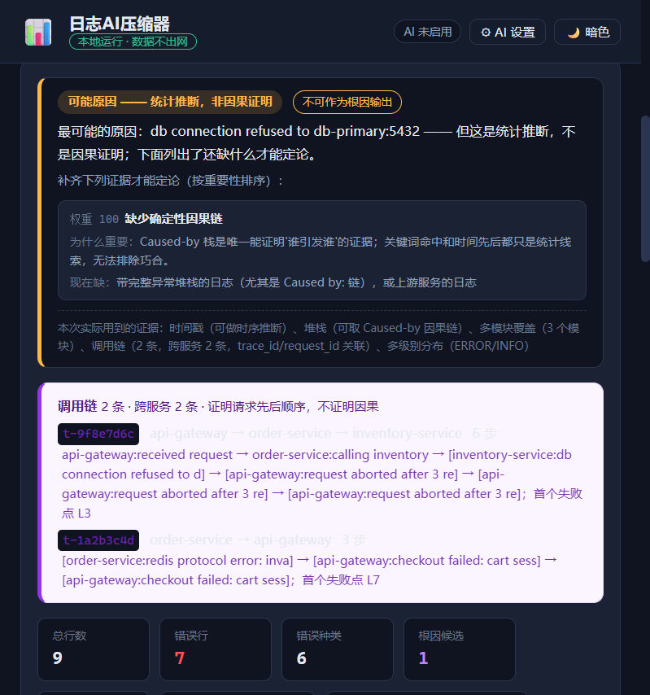

# log-ai-compressor · 本机日志取证层

> **我们不把日志交给大模型。我们用确定性算法把日志变成可复核的证据，大模型只读证据。**
> 拿不出因果链就说证据不足，并精确列出还缺什么才能定论 —— 而且会对这些缺口负责：补上了就把缺口划掉。
> **全部计算在本机完成，日志不出网。**

[](https://github.com/hu-chenyu/log-ai-compressor/actions)
[](https://pypi.org/project/log-ai-compressor/)
[](https://pypi.org/project/log-ai-compressor/)
[](https://github.com/hu-chenyu/log-ai-compressor/blob/main/LICENSE)



---

## 🧾 立场：你不必相信这个工具

大多数日志工具要你**相信**它的结论。这个工具给的是你可以**自己复核**的东西 ——
每条结论都带原文的**行号区间**和那段原文的 **sha256**。

```console
$ log-ai-compressor run app.log -f json -o report.json
$ log-ai-compressor verify --report report.json
证据：共 8 条引用，匹配 8 条，失配 0 条，源不可读 0 条
```

事故复盘时，有人把日志里的主机名改了：

```console
$ log-ai-compressor verify --report report.json
证据：共 8 条引用，匹配 7 条，失配 1 条
  ✗ MISMATCH ca0e981df461 app.log 期望 c33aeb824ce67aaf 实际 4a1689f3780880ae
自校验结论：TAMPERED        # 退出码 1
```

判定只有三档，**没有「大部分通过」** —— 一份掺了假证据的报告，不该因为大部分为真就放行。

**同一套立场长成了四件具体的事：**

| 我们怎么做 | 通常的反面 |
| --- | --- |
| 拿不出 `Caused by` 因果链就只给 `LIKELY`，并**列出还缺什么才能定论**，补上了就划掉 | 给一个听起来很像回事的根因 |
| 同一份日志跑两遍，**结论指纹逐字节相同** | 每次结论都不一样，没法归档、没法追责 |
| 证据摘要只认**文件原始字节**，剥过 ANSI 的文本不算 | 同一行原文，两条出口给两个摘要 |
| **撤回过一个跑不出来的召回率数字（91.4%）**，并公开查了哪六条路径 | 挂着一个复现不了的漂亮数字 |

> 第四行是我最想让你注意的一行：一个**主动撤回自己招牌数字**的项目，
> 它剩下的每个数字才有分量。见 [`docs/FAQ.md` Q10](docs/FAQ.md)。

---

## 📌 先读这一节：这些数字不能证明什么

一个只会报好数字的项目不值得信。下面是**所有实测结论都覆盖不到**的地方。

| 我们**不能**证明 | 原因 |
| --- | --- |
| 根因准确率高于云平台 | RCA100 的结论是 62.5% 的根因案例至少需要两种模态、31% 需要三种。本工具只有日志一种，跟它们不是同一场比赛 |
| 在所有日志形态上都优于 Drain3 | 实测 Loghub **10 个**数据集，**没赢**。同预算档 **8 胜 1 平 1 负**：HPC 输，OpenSSH 打平。交付口径（产品默认只给 20 个簇）更难看，**0 胜 1 平 9 负**。只有"聚类质量上界"的全量口径是 8 胜 1 平 1 负。三个都列在下面 |
| 压缩比能外推到你的日志 | 12289 倍是 OpenStack 全级别摘要口径下的数字。换个数据集、换个 `--context`，数量级就变 |
| 「召回率 100%」代表真实生产事故 | 只在 **1 个**含链真实数据集上测过（Android_v1 全量，131 条链）。**样本小，结论未必能外推**。原先并列的 Hadoop 91.4% 已于 v2.7.0 撤回 |
| 持续监控与告警 | 没有 agent 埋点、没有时序库、没有告警队列 —— 这是有意的取舍，不是没做完 |

> 一个云平台说「我不知道」，在产品上读起来像故障。本工具说「我不知道」，
> 在方法论上读起来像专业。**但如果你要的是全天候告警，本工具给不了，别选它。**

---

## 📊 证据保留率 vs Drain3（Loghub 2.0，10 个数据集）

指标：**保住多少种人工标注的事件类型**。事件模板来自
[Loghub-2.0](https://zenodo.org/record/8275861) 的**人工标注**。

我们报**三个口径**，因为它们回答三个不同的问题，混着说就是不诚实：

- **交付口径** = 产品默认 `top_n=20`，用户开箱即用**真拿到手**的那 20 个簇
- **同预算 32k** = 和 Drain3 花同样的 token 能保住多少（**主指标**）
- **全量口径** = 聚类本身的质量上界，**不是用户能收到的**，别拿它当成绩

| 数据集 | 标注事件 | 交付 top20 | **同预算 32k** | 全量 | Drain3 | LogsLop (AMD) |
|---|---:|---:|---:|---:|---:|---:|
| Proxifier | 11 | 72.7% | **100.0%** | 100.0% | 72.7% | 27.3% |
| Apache | 29 | 55.2% | **100.0%** | 100.0% | 93.1% | 44.8% |
| OpenSSH | 38 | 36.8% | **92.1%** | 92.1% | 92.1% | 34.2% |
| Zookeeper | 89 | 22.5% | **91.0%** | 91.0% | 76.4% | 23.6% |
| Linux | 338 | 2.4% | **89.3%** | 89.3% | 66.6% | 55.6% |
| Hadoop | 236 | 8.5% | **90.7%** | 90.7% | 80.5% | 13.1% |
| HealthApp | 156 | 11.5% | **88.5%** | 88.5% | 83.3% | 7.1% |
| OpenStack | 48 | 37.5% | **52.1%** | 52.1% | 41.7% | 18.8% |
| HPC | 74 | 20.3% | **81.1%** | 81.1% | **87.8%** | 4.1% |
| Mac | 626 | 3.2% | **90.4%** | 90.7% | 72.2% | 16.1% |

**对 Drain3 的战绩：交付口径 0 胜 1 平 9 负 / 同预算 8 胜 1 平 1 负 / 全量 8 胜 1 平 1 负。**

交付口径那一列低得难看，是因为 Mac 有 626 种事件、Linux 有 338 种，
**20 个簇物理上装不下** —— 不是工具差，是产品只给 20 个簇。
把上限算出来看：Zookeeper / Hadoop / Mac **顶格 100%**，全部 10 个数据集合计
**达成度 82%**（实测覆盖率 ÷ `min(20,事件数)/事件数`）。
这一栏量的是「产品给多少簇」，Drain3 没有这个旋钮，**两栏不是同一条起跑线**。
OpenSSH 两边都是 35/38，**是平手不是赢**；Proxifier 两边都是 8/11，也是平手。

**剩下的一个负例不藏，病因查到了「修法不存在」这一步：**

- **HPC 81.1% vs Drain3 87.8%** —— 不是簇数不够，是**簇粒度比标注粗**。
  79 个簇只装下 60 种事件身份，**14 个未覆盖事件全部落在 12 个过度合并的簇上**，
  而它们无一例外只差**一两个字面词元**：`Link error`/`Link ok`、
  `critical`/`normal`、`power/control ok`/`problem`、`boot`/`wait`/`risBoot`。

  试过加「字面词元守卫」拆开：覆盖率从 85.1% 涨到 93.2%，
  **但报告从 76 个簇炸成 2,690 个、交付口径从 23.0% 崩到 8.1%** —— **已撤回**。

  v2.10.0 又走了更远一步：把每一次合并决定都记下来（4,142 次），用 Loghub
  标注判定对错，去找能分开两类的特征。**结论是没有这样的特征** ——
  字符相似度与词元 Jaccard 的两类分布**完全重叠**，Proxifier 甚至有
  Jaccard = 1.000（字面词元集合完全一致）却被 Loghub 判为不同事件的合并。
  **Loghub 的事件定义不是模板相似度的函数**，所以这不是调参问题。
  诊断脚本可复算：`python scripts/diagnose_merge_decisions.py`。

> Mac 在 v2.9.8 之前也是负例（58.5% vs 72.2%）。病因不是聚类丢事件，而是报告
> 把 406 条错误消息当成「变更事件」，逐条写了出来 —— 全篇 33% 的 token 花在
> 这个假线索上。收敛后同预算从 58.5% 涨到 82.9%。
>
> v2.10.0 又从 82.9% 涨到 **90.4%**，与本版修掉的另一件事直接相关：相似度回退
> 曾经只比级别桶里「最近 256 个簇」，这让聚类结果依赖日志行序，且**让长期只出现
> 在桶尾之后的模板永远找不到同类**（Mac 的 INFO 桶因此多出 1,000 个碎片簇）。
> 改成整桶比较 + 精确长度上界剪枝之后，Mac 的 INFO 桶从 1,604 个簇回到 547 个，
> **分析还更快了（25.3s → 14.0s）**。

**胜负怎么判的**：一律按**事件种数**比，不用四舍五入后的百分数。
报告只有 1 位小数，0.05pp 以内的差与舍入误差分不开，**落在容差里一律记平**
（v2.9.6 之前直接比百分数，把一个 0.005pp 的舍入差判成了胜）。

对照的三个都是真工具：Drain3（ICWS'17 学术标准）、
LogsLop（AMD 2026-07，去重工具，与证据保留**目标相反**）、tail/grep 两条朴素基线。

> **这张表现在有门禁在守。** `docs/benchmark_baseline.json` 存着最近一次全量实测，
> `python scripts/prove.py` 的第 11 条主张拿它与这张表**逐格对账** —— 并且不只校这一份：
> 同一张表在 `docs/BENCHMARK.md` 与 `docs/FAQ.md` 里各有一份副本，三份逐格对账；
> 连「几个数据集赢、几个平、几个输」这种汇总口径也一并重算 —— 这批数字曾在
> `docs/BENCHMARK.md` 上漂过 9 格，另有一处把平局当成了赢。具体数字见上表。
> 上一版（v2.9.9）改了 `mask_text` 让 HPC、Zookeeper、Proxifier 的数字全变了，
> 而这张表原地不动、六道门禁全绿 —— 与 v2.9.5 撤回的那次是同一个病，现在补上了对账。

> 完整方法学、**为什么会在一个数据集上输**、以及 v2.9.3「已发布数字系统性偏低」、
> v2.9.5「指标在数用户没收到的东西」、v2.9.8「指标涨了但产品崩了」三次撤回的经过，
> 全在 [`docs/BENCHMARK.md`](docs/BENCHMARK.md)。被质疑时先看那里。

---

## 🚦 工程指标

| 指标 | 实测值 |
| --- | --- |
| 生产代码 | 7,758 行（32 个模块），硬依赖只有 PyYAML |
| 测试 | **1,192 用例**，覆盖率 **96%**（漏行 154 / 3,934 语句），`ruff` 全绿 |
| CI | Ubuntu 3.11 / 3.12 / Windows 3.12 三矩阵，**六道门禁**：ruff / 单测+覆盖率 / 对抗评分卡 / 确定性指纹 / 自证脚本 / 构建可复现性 |
| 自证脚本 | 现已断言 **11 条**主张，含「README 工程指标与架构树必须与仓库一致」「README 写的条数不许漂」「**每一处基准表逐格对账实测基线（含胜负场次）**」 |
| 构建 | 可复现 —— 同源码两次构建字节相同，本地/PyPI/GitHub 三方 sha256 对账 |

---

## 🚀 90 秒上手

```bash
# 本地 Web 界面（自动开浏览器，端口 8765 起，被占用自动顺延）
pip install "log-ai-compressor[web]"
log-ai-compressor web

# 只在命令行里压缩日志：硬依赖只有 PyYAML
pip install log-ai-compressor
log-ai-compressor run app.log --top 20 -o report.md

# 复核一份报告的结论出处（报告发出去后日志可能已被改动或轮转清理）
log-ai-compressor verify --report report.json

# 让 AI Agent 直接调用本机日志（MCP Server，已收录官方 Registry）
pip install "log-ai-compressor[mcp]"
log-ai-compressor mcp --install claude-code
```

Agent 客户端可直接按官方 Registry 名发现安装：

```yaml
mcp-name: io.github.hu-chenyu/log-ai-compressor
```

Windows 可双击 `start.bat` 自动定位 Python、装依赖、启动并打开浏览器。

---

## 🧰 能力

| 领域 | 能做什么 |
| --- | --- |
| **取证** | 每条结论绑定 `evidence_id` + 文件 + 行号区间 + 原文 sha256；`verify` 重读原文逐条核对，被改动报 `TAMPERED` |
| **确定性** | 报告带「确定性指纹」，同一份日志两次分析结论逐字节相同（耗时与速率已排除） |
| **置信三档** | `CONFIRMED` / `LIKELY` / `INSUFFICIENT`。只有条目内 `Caused by:` 链才算 `CONFIRMED`；证据不足时**不输出「根因」措辞**，改为列出还缺什么 |
| **缺口自闭环** | 缺口清单由日志里实际有什么驱动。日志带 `trace_id` → 调用链重建成功 → 「缺少调用链关联」自动关闭；一条都没有就如实申报 |
| **解析** | ISO / syslog / logcat / logfmt / JSON Lines / 中式堆栈；可插拔 YAML 规则改配置不改代码；编码自动适配 UTF-8/GBK/UTF-16/32 + `.gz`/`.zip` |
| **调用链** | 结构化日志里存在 `trace_id` 时重建跨服务链路与首个失败点，不需要装 agent、不需要接拓扑 |
| **Web 界面** | 零构建零 CDN，离线可用；文件浏览器直选本机文件（不走网络）；SSE 实时进度 + 可取消 |
| **AI 解读**（可选） | 在压缩结果之上生成人话解读。**不配 API Key 也能完整用**，AI 只是额外一层 |

完整清单与边界见 [`docs/FEATURES.md`](docs/FEATURES.md)。

---

## 🚫 它做不到什么

| 它做不到 | 为什么 | 谁行 |
| --- | --- | --- |
| **比云平台更高的根因准确率** | 多模态根因需要指标 + 链路 + 拓扑。本工具只有日志一种 | Datadog / SLS / Dynatrace |
| 持续监控与告警 | 没有 agent 埋点、没有时序库、没有告警队列。**这是有意的取舍** | 全部 APM 平台 |
| 调用链追踪 | `traces` 是从日志里的 `trace_id` **重建**的，不是采集的 | Jaeger / Tempo |
| 「召回率」实测 | 只有 **1 个**含链真实数据集（Android_v1 全量，1,555,005 行 / 131 链）。原先并列的 Hadoop 91.4% 已于 v2.7.0 撤回。**一个真实数据集撑不起「召回率」这个说法，这是本项目最实在的短板** | — |
| 隐私合规认证 | 它不处理合规，只保证「数据不出本机」 | — |

还有一条是**写在代码里而不只是文档里**的硬约束：

> **调用链只证明顺序，不证明因果。** 有完整 trace 但没有 `Caused by:` 时，
> 工具仍然只给 `LIKELY`、`can_conclude=false`。`CONFIRMED` 的唯一来源
> 始终是条目内 Caused-by 链。对抗评测里有一个场景专门盯它。

---

## 🗂 深入

| 文档 | 里面有什么 |
| --- | --- |
| [`docs/BENCHMARK.md`](docs/BENCHMARK.md) | 全部实测的方法学、口径、公平性说明、**两处落后的病因**、撤回记录 |
| [`docs/EVALUATION.md`](docs/EVALUATION.md) | 对抗性评测（专门设计来误导本工具的 10 个场景）+ 置信档位实测 |
| [`docs/FAQ.md`](docs/FAQ.md) | 逐条回答质疑：「凭什么比 Drain3 强」「自信错误率是不是门槛设高了」… |
| [`docs/POSITIONING.md`](docs/POSITIONING.md) | 与全品类日志工具的差异论证 |
| [`docs/FEATURES.md`](docs/FEATURES.md) | 完整能力清单 |
| [`docs/ARCHITECTURE.md`](docs/ARCHITECTURE.md) | 模块树、分层依赖、核心算法 |
| [`docs/CLI.md`](docs/CLI.md) | 完整命令行用法 + 自定义解析规则 |
| [`docs/DEVELOPMENT.md`](docs/DEVELOPMENT.md) | 开发、测试、门禁说明 |
| [`AGENTS.md`](AGENTS.md) | **给 AI agent 的工作契约**：分层与唯一门面、六道门禁各自守什么、这个仓库特有的坑 |
| [`CONTRIBUTING.md`](CONTRIBUTING.md) | 人类贡献流程：分支、提交约定、基准纪律、发版与三方 sha256 对账 |
| `SKILL.md` / `INSTRUCTIONS` | 接入 Claude Code / Codex / Mavis 等 Agent |

**复现本文所有数字：**

```bash
python scripts/fetch_datasets.py --all   # 下公开数据集
python scripts/benchmark_loghub.py       # 证据保留率对照
python scripts/prove.py                  # 自证：不必相信作者，自己跑
```

## License

MIT
